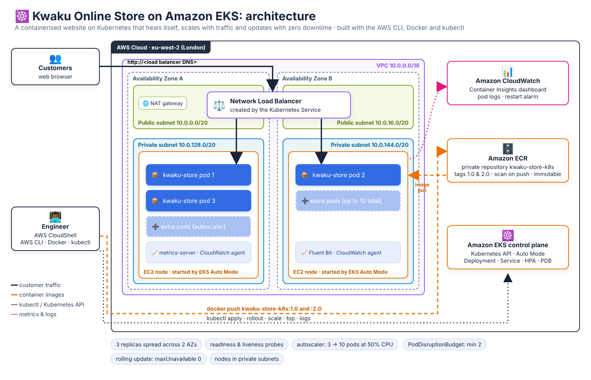
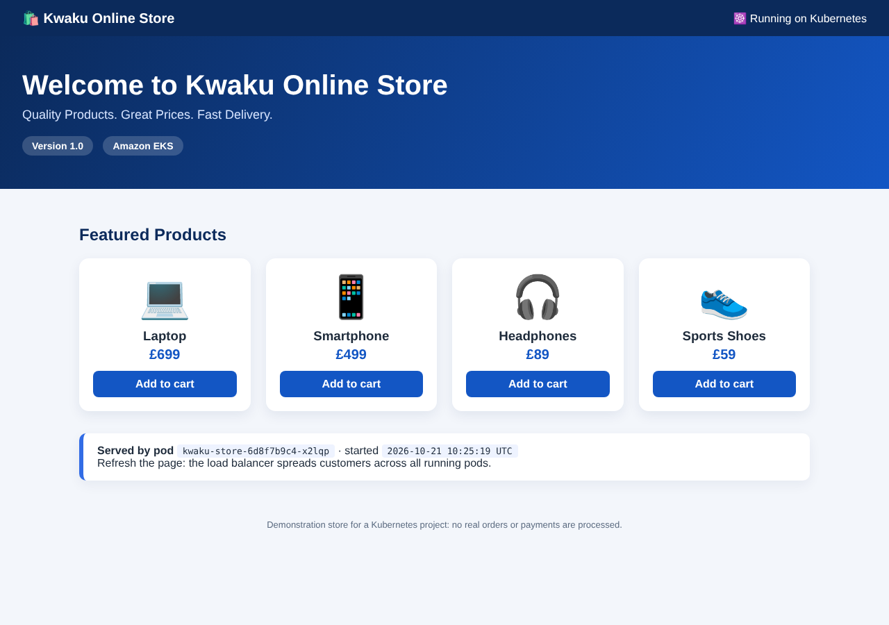
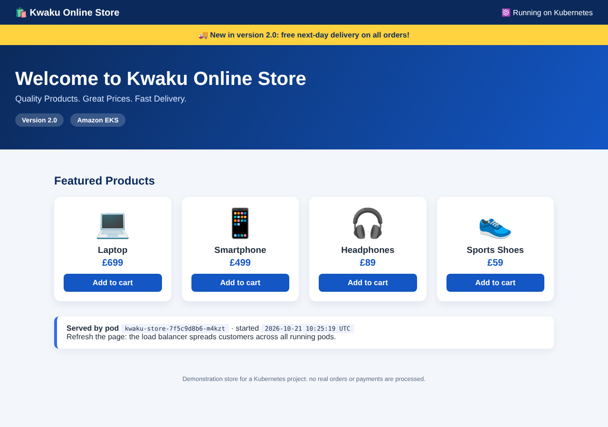

# ☸️ Self-Healing, Auto-Scaling Online Store on Kubernetes (Amazon EKS)


I containerised an online store with **Docker** and stored the image in **Amazon ECR**. I then ran it on **Kubernetes (Amazon EKS)** across two data centres. **I proved by testing that it:**

- **repairs itself** when pods crash or are deleted,
- **scales** from 3 to 10 copies during a traffic spike,
- **ships a new version with zero downtime** (and can roll back),
- is **monitored** with CloudWatch Container Insights.

I built everything from the command line with the AWS CLI, Docker and kubectl.

---

## ⏱️ The project in 30 seconds

| | |
|---|---|
| **Problem** | An online store on a single server goes down when that server fails, slows down at busy times and needs downtime for every update |
| **Solution** | Run the store as containers on Kubernetes: 3 copies spread over 2 Availability Zones, behind a load balancer, with health checks, autoscaling and rolling updates |
| **Proof** | Scripts that break pods while a "customer" keeps using the site, generate a traffic spike, and release version 2.0 live, then print what happened |
| **AWS services** | Amazon EKS (Auto Mode), Amazon ECR, Elastic Load Balancing (NLB), Amazon VPC, IAM, Amazon CloudWatch |
| **Tools** | AWS CLI, Docker, kubectl, Bash |
| **Skills** | Kubernetes, containers, orchestration, scaling, troubleshooting, monitoring, networking, IAM |



| Version 1.0 (first release) | Version 2.0 (rolled out with zero downtime) |
|---|---|
|  |  |

The panel under the products shows **which pod (container) served the page**. Refresh the page and the name changes: the load balancer shares customers between all the running copies.

---

## Contents

1. [The business problem](#1-the-business-problem)
2. [The solution](#2-the-solution)
3. [What I proved](#3-what-i-proved)
4. [Architecture](#4-architecture)
5. [Kubernetes in plain English](#5-kubernetes-in-plain-english)
6. [Project structure](#6-project-structure)
7. [Prerequisites](#7-prerequisites)
8. [Step-by-step guide](#8-step-by-step-guide)
9. [Troubleshooting](#9-troubleshooting)
10. [Cost](#10-cost)
11. [Security and design decisions](#11-security-and-design-decisions)
12. [Skills demonstrated](#12-skills-demonstrated)
13. [For recruiters: project summary](#13-for-recruiters-project-summary)
14. [Project checklist](#14-project-checklist)

---

## 1. The business problem

**Kwaku Online Store** sells laptops, phones, headphones and shoes online. Today the website runs on one server, which causes four problems:

| Problem | Business impact |
|---------|-----------------|
| ❌ When the server or the web process crashes, the store is **offline** until someone fixes it by hand | Lost sales, unhappy customers |
| ❌ During sales and holidays the single server **slows down or fails** | Lost sales at the most valuable moments |
| ❌ Every update means **taking the site down** | Updates are done at night, rarely, and are risky |
| ❌ Nobody can see CPU, memory, errors or restarts until customers complain | Slow troubleshooting |

## 2. The solution

Package the website as a **container image** and let **Kubernetes** run and look after it:

| Requirement | How this project meets it |
|-------------|---------------------------|
| Stay online when something fails | **3 replicas** (copies) spread over **2 Availability Zones**. Health probes find broken containers, and Kubernetes **replaces them automatically** |
| Handle traffic spikes | A **Horizontal Pod Autoscaler** adds pods (3 → 10) when CPU goes above 50%. **EKS Auto Mode** adds EC2 servers when the pods need room |
| Update without downtime | **Rolling updates** replace pods one at a time and never drop below 3 ready pods. Bad releases are undone with **`kubectl rollout undo`** |
| Know what is happening | **metrics-server** (`kubectl top`) and **CloudWatch Container Insights** for metrics, dashboards and pod logs. A **CloudWatch alarm** watches for restart loops |
| Keep it secure | Servers in **private subnets** with no public IPs. A **private ECR** repository with **vulnerability scanning**. **Least-privilege IAM roles** |

## 3. What I proved

Every claim above is tested by a script in this repository:

| Test | Script | What happens | Expected result |
|------|--------|--------------|-----------------|
| Load balancing | `08-get-website-url.sh` | Sends 10 requests to the public URL | Answers come from different pod names |
| **Self-healing: pod deleted** | `09-test-self-healing.sh` | Deletes a pod while a "customer" requests the site twice a second | A new pod is created and ready within seconds, and the site keeps answering |
| **Self-healing: crash** | `09-test-self-healing.sh` | Stops the web server inside a container | Kubernetes restarts the container (`RESTARTS` goes from 0 to 1) |
| **Self-healing: 2 of 3 pods lost** | `09-test-self-healing.sh` | Deletes two pods at once | Both are replaced. The script prints the availability % for the whole test |
| **Autoscaling** | `10-test-autoscaling.sh` | Load generator pods flood the site | The HPA scales 3 → 6+ pods, then back to 3 when the load stops |
| **Zero-downtime update** | `11-rolling-update.sh` | Builds and releases version 2.0 | Pods are replaced one by one. The yellow 2.0 banner appears |
| **Rollback** | `11-rolling-update.sh rollback` | Undoes the release | Back to 1.0 in about a minute |
| **Monitoring** | `12-monitoring.sh` | Shows metrics, events and logs, and creates an alarm | Container Insights metrics, CloudWatch logs, and an alarm in state `OK` |

> 📸 When you run the project, save your own screenshots in [`screenshots/`](screenshots/) as evidence (list of shots to take in that folder).

## 4. Architecture

```
Customers ──► Network Load Balancer (public subnets, 2 AZs)
                     │
                     ▼
      ┌─────────────── Amazon EKS cluster (Auto Mode) ───────────────┐
      │  Private subnet AZ-A               Private subnet AZ-B        │
      │  ┌──────────── EC2 node ─────┐     ┌──────────── EC2 node ─┐  │
      │  │ kwaku-store pod 1         │     │ kwaku-store pod 2     │  │
      │  │ kwaku-store pod 3         │     │ (+ pods 4-10 if busy) │  │
      │  └───────────────────────────┘     └───────────────────────┘  │
      │  Deployment · Service · HPA · PodDisruptionBudget             │
      └────────────────────────────────────────────────────────────────┘
          ▲ image pull                               │ metrics & logs
   Amazon ECR (kwaku-store-k8s:1.0, :2.0)      Amazon CloudWatch (Container Insights)
          ▲ docker push
   Engineer in AWS CloudShell (AWS CLI · Docker · kubectl)
```

| Component | Purpose |
|-----------|---------|
| **VPC** (10.0.0.0/16) | Private network: 2 public subnets for the load balancer and NAT gateway, 2 private subnets for the servers |
| **NAT gateway** | Lets the private servers reach the internet (for updates) without being reachable from it |
| **Amazon EKS (Auto Mode)** | Managed Kubernetes. Auto Mode also creates, patches and removes the EC2 worker nodes, the load balancer controller and storage driver |
| **Amazon ECR** | Private Docker image registry with scan-on-push and immutable tags |
| **Deployment** | Runs 3 identical pods of the website, replaces failed ones, and performs rolling updates |
| **Service (LoadBalancer)** | One stable address for all pods. EKS creates an AWS **Network Load Balancer** for it |
| **HorizontalPodAutoscaler** | Changes the number of pods (3-10) based on CPU |
| **PodDisruptionBudget** | Keeps at least 2 pods running during node maintenance |
| **metrics-server add-on** | Live CPU and memory for `kubectl top` and the autoscaler |
| **CloudWatch Observability add-on** | Container Insights metrics, dashboards and pod logs in CloudWatch |

## 5. Kubernetes in plain English

| Term | Meaning |
|------|---------|
| **Container / image** | The website packaged with everything it needs. The image is the package, a container is a running copy of it |
| **Pod** | The smallest thing Kubernetes runs: here, one container of the website |
| **Node** | A server (EC2 instance) that runs pods |
| **Deployment** | "Always keep 3 pods of version X running". Kubernetes constantly fixes any difference |
| **Service** | A fixed address in front of changing pods (pods come and go, the Service stays) |
| **Readiness / liveness probe** | Health checks: *ready* means "send me customers", *live* means "I'm not stuck" |
| **HPA** | Horizontal Pod Autoscaler: more pods when busy, fewer when quiet |
| **Rolling update** | Replace old pods with new ones gradually, so the site never goes down |
| **Namespace** | A folder that keeps this project's objects together |

## 6. Project structure

```
aws-eks-kubernetes-store-cli/
├── app/                          # the website container
│   ├── Dockerfile                # NGINX image + the store page
│   ├── index.html                # Kwaku Online Store page (shows version and pod name)
│   ├── nginx.conf                # /health endpoint for probes, /info.json for tests
│   └── 40-pod-info.sh            # runs at container start: writes pod name + version into the page
├── k8s/                          # Kubernetes manifests
│   ├── namespace.yaml
│   ├── deployment.yaml           # 3 replicas, probes, resources, rolling update, AZ spread
│   ├── service.yaml              # LoadBalancer → AWS Network Load Balancer
│   ├── hpa.yaml                  # autoscaling 3-10 pods at 50% CPU
│   └── pdb.yaml                  # at least 2 pods during maintenance
├── iam/                          # trust policies for the cluster and node roles
├── scripts/                      # one script per step, run in order
│   ├── config.sh                 # settings shared by every script (region, names)
│   ├── 01-create-network.sh      # VPC, subnets, internet + NAT gateway, routes
│   ├── 02-create-iam-roles.sh    # cluster role and node role
│   ├── 03-create-cluster.sh      # EKS cluster in Auto Mode
│   ├── 04-connect-kubectl.sh     # kubeconfig
│   ├── 05-install-addons.sh      # metrics-server + CloudWatch Observability
│   ├── 06-build-push-image.sh    # docker build → Amazon ECR
│   ├── 07-deploy-website.sh      # kubectl apply
│   ├── 08-get-website-url.sh     # load balancer URL + load-balancing test
│   ├── 09-test-self-healing.sh   # delete/crash pods while measuring availability
│   ├── 10-test-autoscaling.sh    # traffic spike → HPA scales out and in
│   ├── 11-rolling-update.sh      # release 2.0, then roll back
│   ├── 12-monitoring.sh          # kubectl top, events, logs, Container Insights, alarm
│   └── 99-cleanup.sh             # delete everything
├── docs/images/                  # architecture diagram and website screenshots
└── screenshots/                  # your own evidence from the AWS console
```

## 7. Prerequisites

| You need | Notes |
|----------|-------|
| An AWS account | Permission to manage VPC, EC2, IAM, EKS, ECR, Elastic Load Balancing and CloudWatch |
| **AWS CloudShell** (recommended) | Has the AWS CLI, kubectl, Docker and git already installed: nothing to install on your laptop |
| or your own terminal | AWS CLI v2, kubectl, Docker, git, python3, curl |

> 💷 **This project creates paid resources** (about **$0.35-0.50 per hour**, see [Cost](#10-cost)). Run the cleanup step when you finish.

---

## 8. Step-by-step guide

Every step is a short script you can read before you run it. The most important commands are shown below each step so you can see what is happening.

### Step 0: Open CloudShell and get the code

Sign in to the AWS Console and select **Europe (London) eu-west-2** at the top right. Then click the **CloudShell** icon (`>_`).

```bash
git clone https://github.com/KwakuAdae/aws-eks-kubernetes-store-cli.git
cd aws-eks-kubernetes-store-cli
aws sts get-caller-identity        # check which account you are using
```

To use another region or names, export them first. For example, `export AWS_REGION=eu-west-1` (see `scripts/config.sh`).

### Step 1: Create the network (~3 minutes)

```bash
./scripts/01-create-network.sh
```

This creates a VPC with **2 public subnets** (load balancer, NAT gateway) and **2 private subnets** (servers), in two Availability Zones. It also creates an internet gateway, a NAT gateway and route tables. The subnets get the tags EKS uses to find where to put load balancers:

```bash
aws ec2 create-subnet --vpc-id "$VPC_ID" --cidr-block 10.0.0.0/20 --availability-zone "$AZ_A" \
  --tag-specifications "ResourceType=subnet,Tags=[{Key=kubernetes.io/role/elb,Value=1},...]"
aws ec2 create-nat-gateway --subnet-id "$PUBLIC_SUBNET_A" --allocation-id "$EIP_ALLOC"
```

The IDs are saved in `.lab-env` so the next steps can use them.

### Step 2: Create the IAM roles (~10 seconds)

```bash
./scripts/02-create-iam-roles.sh
```

| Role | Used by | Policies |
|------|---------|----------|
| `kwaku-store-eks-cluster-role` | EKS control plane | `AmazonEKSClusterPolicy` plus the 4 Auto Mode policies (compute, block storage, load balancing, networking) |
| `kwaku-store-eks-node-role` | EC2 worker nodes | `AmazonEKSWorkerNodeMinimalPolicy`, `AmazonEC2ContainerRegistryPullOnly` (pull from ECR), `CloudWatchAgentServerPolicy` (send metrics and logs) |

### Step 3: Create the EKS cluster (~10-15 minutes)

```bash
./scripts/03-create-cluster.sh
```

The script writes every setting to `cluster.json`, so you can read it, then runs:

```bash
aws eks create-cluster --cli-input-json file://cluster.json
aws eks wait cluster-active --name kwaku-store-eks
```

Key settings: **Auto Mode** on (`computeConfig`, `elasticLoadBalancing`, `blockStorage`), nodes in the **private** subnets, and **access entries** (`authenticationMode: API`) so you are cluster admin as the creator.

### Step 4: Connect kubectl

```bash
./scripts/04-connect-kubectl.sh
```

```bash
aws eks update-kubeconfig --name kwaku-store-eks --region eu-west-2
kubectl cluster-info
kubectl get nodes        # "No resources found" is normal: Auto Mode starts nodes only when pods need them
```

### Step 5: Install the add-ons (~3 minutes)

```bash
./scripts/05-install-addons.sh
```

```bash
aws eks create-addon --cluster-name kwaku-store-eks --addon-name metrics-server
aws eks create-addon --cluster-name kwaku-store-eks --addon-name amazon-cloudwatch-observability
kubectl top nodes
```

- **metrics-server** supplies the CPU numbers the autoscaler needs.
- **amazon-cloudwatch-observability** turns on **Container Insights**.

### Step 6: Build the image and push it to Amazon ECR (~2 minutes)

```bash
./scripts/06-build-push-image.sh 1.0
```

```bash
aws ecr create-repository --repository-name kwaku-store-k8s \
  --image-scanning-configuration scanOnPush=true --image-tag-mutability IMMUTABLE
aws ecr get-login-password | docker login --username AWS --password-stdin "$REGISTRY"
docker build --platform linux/amd64 --build-arg APP_VERSION=1.0 -t "$ECR_URI:1.0" app/
docker push "$ECR_URI:1.0"
```

The image is the official NGINX image plus the store page. At start-up, `40-pod-info.sh` writes the **pod name** and **version** into the page, so you can see Kubernetes at work. The script ends by showing the ECR **vulnerability scan** result.

### Step 7: Deploy the website to Kubernetes (~2-4 minutes)

```bash
./scripts/07-deploy-website.sh
```

```bash
kubectl apply -f k8s/namespace.yaml
sed -e "s|__IMAGE__|$ECR_URI:1.0|" -e "s|__VERSION__|1.0|" k8s/deployment.yaml | kubectl apply -f -
kubectl apply -f k8s/service.yaml -f k8s/hpa.yaml -f k8s/pdb.yaml
kubectl rollout status deployment/kwaku-store -n kwaku-store
```

The important parts of [`k8s/deployment.yaml`](k8s/deployment.yaml):

```yaml
replicas: 3
strategy:
  rollingUpdate: { maxUnavailable: 0, maxSurge: 1 }   # never fewer than 3 ready pods during updates
...
resources:
  requests: { cpu: 100m, memory: 64Mi }               # what the autoscaler measures against
readinessProbe: { httpGet: { path: /health, port: 80 } }   # only send traffic to ready pods
livenessProbe:  { httpGet: { path: /health, port: 80 } }   # restart a stuck container
```

Auto Mode notices the 3 pending pods and **starts EC2 nodes** for them, with no node group to manage:

```bash
kubectl get pods -n kwaku-store -o wide
kubectl get nodes -L topology.kubernetes.io/zone
```

### Step 8: Open the website (~3-5 minutes)

```bash
./scripts/08-get-website-url.sh
```

The script waits for the Network Load Balancer, then sends 10 requests. Each answer names the pod that served it (example output):

```
{"pod":"kwaku-store-6d8f7b9c4-x2lqp","version":"1.0","started":"..."}
{"pod":"kwaku-store-6d8f7b9c4-9hj4t","version":"1.0","started":"..."}
{"pod":"kwaku-store-6d8f7b9c4-p7wnc","version":"1.0","started":"..."}
```

Open the printed `http://...elb.eu-west-2.amazonaws.com` URL in your browser and refresh a few times. The pod name changes. 📸 *Screenshot: the store in the browser.*

### Step 9: Test self-healing ⭐

```bash
./scripts/09-test-self-healing.sh
```

A background "customer" requests the site **twice a second** during three tests:

| Test | Command used | What Kubernetes does |
|------|--------------|----------------------|
| A. Delete a pod | `kubectl delete pod <pod>` | The Deployment sees 2 of 3 and **creates a new pod** |
| B. Crash the web server | `kubectl exec <pod> -- nginx -s stop` | The container exits and the kubelet **restarts it** (`RESTARTS` 0 → 1) |
| C. Delete 2 pods at once | `kubectl delete pod <pod1> <pod2>` | **Both are replaced** while the third pod keeps serving |

The script prints how long each recovery took. It ends with the **customer's view**: requests sent, successful, failed and **availability %**. 📸 *Screenshot: the summary and `kubectl get pods` showing new pods.*

To try it by hand in a second CloudShell tab:

```bash
kubectl get pods -n kwaku-store -w                    # watch pods live
kubectl delete pod <pod-name> -n kwaku-store          # in the other tab
```

### Step 10: Test autoscaling ⭐

```bash
./scripts/10-test-autoscaling.sh
```

The script:

1. Starts 4 **load-generator** pods that request the home page non-stop.
2. Every 15 seconds, prints the autoscaler's view (example output):

```
   12:01:15  CPU   12% of request (target 50%)  pods: 3 → 3
   12:01:45  CPU  148% of request (target 50%)  pods: 3 → 9
   12:02:15  CPU   61% of request (target 50%)  pods: 9 → 10
```

3. Stops the load, then watches the HPA scale back down to 3 pods (after a 2-minute calm period).

If the cluster runs out of room, **Auto Mode adds another EC2 node** automatically. Watch `kubectl get nodes`. 📸 *Screenshot: `kubectl get hpa` during the spike.*

Not scaling? Add more load: `LOAD_PODS=8 ./scripts/10-test-autoscaling.sh`.

### Step 11: Zero-downtime rolling update and rollback ⭐

```bash
./scripts/11-rolling-update.sh            # build, push and release version 2.0
```

```bash
kubectl set image deployment/kwaku-store -n kwaku-store web="$ECR_URI:2.0"
kubectl rollout status deployment/kwaku-store -n kwaku-store
kubectl rollout history deployment/kwaku-store -n kwaku-store
```

Kubernetes starts one 2.0 pod. It waits until the pod passes its readiness probe, then removes one 1.0 pod, and repeats. Refresh the browser: the **yellow "New in version 2.0" banner** appears. 📸 *Screenshot: version 2.0 in the browser.*

Something wrong with the release? Roll back:

```bash
./scripts/11-rolling-update.sh rollback   # kubectl rollout undo
```

### Step 12: Monitoring and troubleshooting

```bash
./scripts/12-monitoring.sh
```

| What | Command |
|------|---------|
| Live CPU / memory | `kubectl top nodes`, `kubectl top pods -n kwaku-store` |
| What happened recently | `kubectl get events -n kwaku-store --sort-by=.lastTimestamp` |
| Logs from all pods | `kubectl logs -n kwaku-store -l app=kwaku-store --prefix` |
| Log groups in CloudWatch | `aws logs describe-log-groups --log-group-name-prefix /aws/containerinsights/kwaku-store-eks/` |
| Container Insights metrics | `aws cloudwatch get-metric-statistics --namespace ContainerInsights --metric-name pod_cpu_utilization ...` |
| Restart-loop alarm | `aws cloudwatch put-metric-alarm --alarm-name kwaku-store-eks-pod-restarts ...` |

The script prints a link to the **Container Insights dashboard** (CloudWatch → Insights → Container Insights). 📸 *Screenshot: the dashboard for the cluster.*

### Step 13: Clean up (~15-20 minutes) ⚠️

```bash
./scripts/99-cleanup.sh
```

This deletes everything **in the order AWS needs**:

1. The Service (which removes the load balancer).
2. The add-ons.
3. The cluster (and the Auto Mode nodes).
4. The NAT gateway and Elastic IP.
5. The gateways, subnets, route tables and VPC.
6. The IAM roles.
7. The ECR repository.
8. The CloudWatch log groups and alarm.

Resources are found by their `Project` tag, so cleanup works even if `.lab-env` is lost. Afterwards, check the console: **EKS → Clusters**, **EC2 → Load Balancers**, **VPC → NAT gateways** and **ECR → Repositories** should all be empty of this project's resources.

---

## 9. Troubleshooting

| Symptom | Likely cause | Fix |
|---------|--------------|-----|
| Pods stay `Pending` for a few minutes | Auto Mode is starting an EC2 node | Wait 1-3 minutes. `kubectl describe pod <pod> -n kwaku-store` → Events |
| `ImagePullBackOff` | Wrong image name/tag, or the node role cannot pull from ECR | `kubectl describe pod`. Check that `aws ecr describe-images --repository-name kwaku-store-k8s` lists the tag, and that the node role has `AmazonEC2ContainerRegistryPullOnly` |
| `exec format error` / `CrashLoopBackOff` right away | Image built for ARM (Apple Silicon) | Build with `--platform linux/amd64` (the script already does) |
| `EXTERNAL-IP` stays `<pending>` | Subnet tags missing, or the cluster was not created in Auto Mode | `kubectl describe service kwaku-store -n kwaku-store`. Check `kubernetes.io/role/elb` on the public subnets |
| URL does not answer yet | DNS and target health checks take a few minutes | Wait 2-5 minutes and run `curl -I <url>` |
| HPA shows `<unknown>/50%` | metrics-server not ready, or pods have no CPU request | `kubectl get apiservice v1beta1.metrics.k8s.io`, `kubectl top pods -n kwaku-store` |
| A few failed requests during the self-healing test | The load balancer takes a few seconds to stop sending traffic to a removed pod | The `preStop` sleep in the Deployment reduces this. Production setups add a longer drain period |
| `error: You must be logged in to the server (Unauthorized)` | kubectl uses another identity than the cluster creator | Run the scripts with the identity that created the cluster, or add an access entry: `aws eks create-access-entry` |
| No Container Insights data | The add-on needs a few minutes, or the node role lacks `CloudWatchAgentServerPolicy` | `aws eks describe-addon --cluster-name kwaku-store-eks --addon-name amazon-cloudwatch-observability` |

## 10. Cost

| Resource | Approximate price (eu-west-2) |
|----------|-------------------------------|
| EKS control plane | $0.10 per hour |
| EC2 nodes (Auto Mode picks the size) + Auto Mode fee | A few cents per hour per node, more during the autoscaling test |
| NAT gateway | About $0.05 per hour + data processed |
| Network Load Balancer | About $0.025 per hour + usage |
| Public IPv4 addresses | $0.005 per hour each |
| ECR, CloudWatch metrics and logs | A few cents for this project |

Expect roughly **$0.35-0.50 per hour**. A 3-hour session costs about **$1.50**. **Always run step 13.** You can also set a budget alert in **Billing → Budgets**.

## 11. Security and design decisions

| Decision | Why |
|----------|-----|
| Worker nodes in **private subnets** | Nodes have no public IP. Only the load balancer is internet-facing |
| **Private ECR**, scan on push, **immutable tags** | Images are scanned for vulnerabilities, and a released version can never be silently replaced |
| **Least-privilege IAM** | AWS-managed policies scoped to EKS. The node role can only *pull* from ECR |
| **Access entries** instead of the old `aws-auth` ConfigMap | The current EKS way to manage who can use the cluster |
| **Resource requests and limits** | Fair scheduling, predictable autoscaling, and one pod cannot starve the others |
| **Readiness and liveness probes** | Traffic only goes to healthy pods, and stuck pods are restarted |
| **maxUnavailable: 0** + **PodDisruptionBudget** | Capacity never drops during updates or node maintenance |
| **Topology spread** over Availability Zones | One AZ failing does not take the store down |
| **EKS Auto Mode** | No node groups to patch or scale by hand. AWS manages the nodes |

**Limitations (learning environment):** the site uses HTTP only (no TLS certificate or custom domain). There is one NAT gateway (one AZ) to keep costs down, and the cluster API endpoint is public. For production, add HTTPS with ACM, put a NAT gateway in each AZ, restrict the API endpoint, and deploy with a CI/CD pipeline or GitOps.

## 12. Skills demonstrated

| Area | Evidence in this project |
|------|--------------------------|
| **Kubernetes** | Deployment, Service, HPA, PDB, Namespace, probes, resources, topology spread, rolling updates, rollback |
| **Containers** | Dockerfile, build arguments, entrypoint scripts, multi-version images, cross-platform builds |
| **Container orchestration** | Self-healing, scheduling across AZs, scaling pods and nodes (EKS Auto Mode) |
| **AWS** | EKS, ECR, VPC networking (public/private subnets, NAT), Network Load Balancer, IAM roles, CloudWatch |
| **Scaling** | Horizontal Pod Autoscaler with metrics-server. Auto Mode node scaling under load |
| **Monitoring** | `kubectl top`, events and logs, CloudWatch Container Insights, CloudWatch alarm |
| **Troubleshooting** | `kubectl describe`/`events`/`logs`, a documented symptom → cause → fix table |
| **Automation** | Idempotent Bash scripts using the AWS CLI, ordered tag-based cleanup |

## 13. For recruiters: project summary

> **Project: Self-Healing, Auto-Scaling E-Commerce Website on Kubernetes (Amazon EKS)**
>
> **Business problem:** An online store on a single server suffered downtime when the server failed. It also slowed down during traffic peaks and needed downtime for every update.
>
> **Solution:** I containerised the website with Docker, stored the image in a private Amazon ECR repository and deployed it to Amazon EKS (Auto Mode). It runs as 3 replicas across 2 Availability Zones, behind a Network Load Balancer. I built everything with the AWS CLI and kubectl.
>
> - Configured readiness and liveness probes, resource requests and limits, a PodDisruptionBudget and zero-downtime rolling updates.
> - Demonstrated **self-healing**: deleted and crashed pods while measuring availability from a customer's point of view.
> - Demonstrated **autoscaling** from 3 to 10 pods with a Horizontal Pod Autoscaler during a simulated traffic spike.
> - Released version 2.0 with **zero downtime** and rolled it back with `kubectl rollout undo`.
> - Set up **monitoring** with metrics-server, CloudWatch Container Insights, centralised pod logs and a restart alarm.
> - Kept the nodes in private subnets, scanned images on push and used least-privilege IAM roles.
>
> **Skills:** Kubernetes, Amazon EKS, Docker, Amazon ECR, kubectl, AWS CLI, VPC networking, IAM, Elastic Load Balancing, CloudWatch, scaling, troubleshooting, monitoring.

## 14. Project checklist

- [ ] VPC with public and private subnets in two AZs
- [ ] IAM roles for the cluster and the nodes
- [ ] EKS cluster in Auto Mode is ACTIVE
- [ ] kubectl connected
- [ ] metrics-server and CloudWatch Observability add-ons installed
- [ ] Image built and pushed to ECR (scan result checked)
- [ ] Website deployed with 3 pods across AZs
- [ ] Website reachable through the Network Load Balancer
- [ ] Self-healing tested (pod deleted, container crashed, 2 pods lost)
- [ ] Autoscaling tested (scale out and back in)
- [ ] Version 2.0 rolled out with zero downtime, and rollback tested
- [ ] Container Insights dashboard, logs and alarm reviewed
- [ ] Screenshots saved in `screenshots/`
- [ ] All AWS resources deleted

## Related projects

- [aws-high-availability-store-cli](https://github.com/KwakuAdae/aws-high-availability-store-cli): the same store on EC2 with an Application Load Balancer and Auto Scaling
- [aws-cloud-monitoring-cloudformation](https://github.com/KwakuAdae/aws-cloud-monitoring-cloudformation): CloudWatch dashboards, alarms and notifications with CloudFormation
- [aws-jenkins-cicd-terraform](https://github.com/KwakuAdae/aws-jenkins-cicd-terraform): CI/CD pipeline for the store with Jenkins and Terraform
- [aws-eks-auto-mode-cli-lab](https://github.com/KwakuAdae/aws-eks-auto-mode-cli-lab): an introduction to EKS Auto Mode with the AWS CLI

## Author

**Kwaku Adae**: [github.com/KwakuAdae](https://github.com/KwakuAdae)

## License

[MIT](LICENSE)
